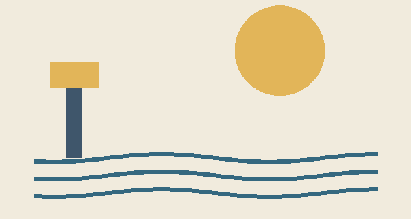

# A place to begin

Mira reached the harbour before sunrise. The little lamp was still lit.
She left a note: *please keep it burning*.

The first image is a figure. This book has **no cover**.

## A note for the next traveller

> A light can be small and still be useful.

1. Read the sign.
2. Follow the shore.
3. Leave the lamp for someone else.

The sign said {{fr|ltr|Bienvenue}}. The map is described in
[the next chapter](#h-3). For background, visit the
[CommonMark specification](https://spec.commonmark.org/0.31.2/).

# The return

On the way home, Mira wrote `lamp = on` in her notebook.

A preserved line break follows:\
The lamp is still here.

---

The end is a place to begin again.
